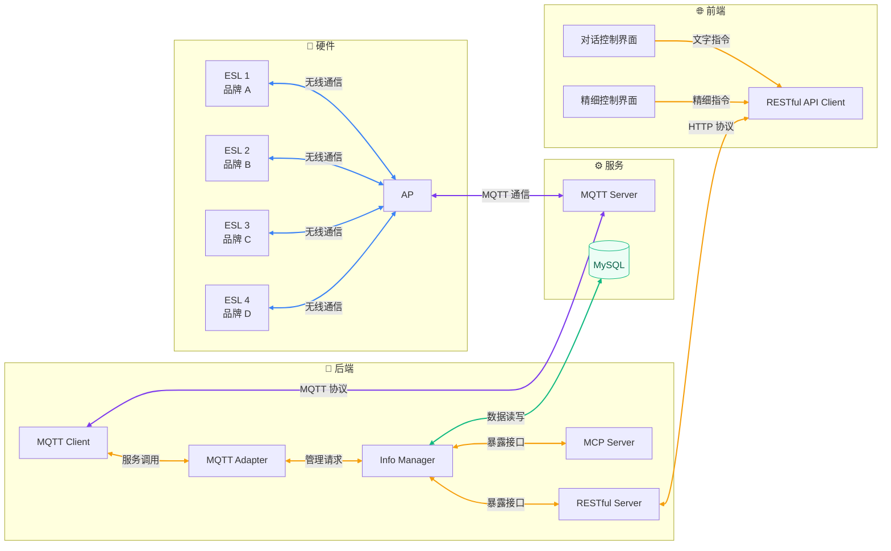

## 📋 Description
MQTT ESL project develop team.

## 🎯 Ultimate Goal
为商店更换智能电子价签及配备电子价签管理系统。
电子价签管理系统需要分别适配不同品牌的电子价签。

## 🏗️ Structure


## 🧩 Module Features
### 🧠 Backend
[mqtt-esl-management-backend](https://github.com/MQTT-ESL-Dev/mqtt-esl-management-backend)
* Language: Python
* Dependencies:
```toml
dependencies = [
    "pydantic",
    "paho-mqtt",
    "sqlalchemy",
    "sqlmodel",
    "fastapi[standard]",
]
```
#### MQTT Adapter
适配不同品牌、不同型号的 MQTT 响应，并对数据进行清洗和标准化处理后交给 `Info Manager`。

#### MQTT Client
通过 `paho-mqtt` 库与 MQTT Server 建立通信连接并进行相关操作。

#### Info Manager
负责数据库连接和信息存储。

#### MCP Server
提供 MCP 接口。

#### RESTful Server
提供 RESTful HTTP 接口。

### 🌐 Frontend
[mqtt-esl-management-frontend](https://github.com/MQTT-ESL-Dev/mqtt-esl-management-frontend)
* Language: Typescript
* Build Tool: Vite
* Framework: Vue
#### 对话控制界面
通过文字输入生成控制指令，适合批量、粗略地修改多个 ESL。

#### 精细控制界面
展示 ESL 在线状态，支持对单个 ESL 进行精细化修改。
