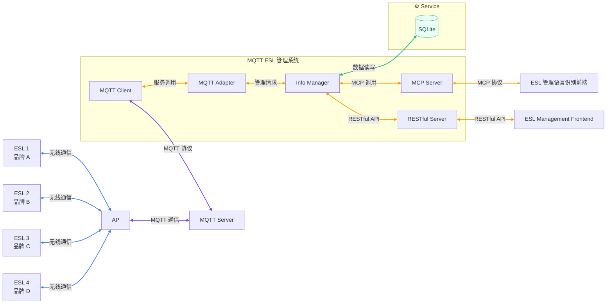

## 📋 Description
MQTT ESL project develop team.

## 🎯 Ultimate Goal
为商店更换智能电子价签及配备电子价签管理系统。
电子价签管理系统需要分别适配不同品牌的电子价签。

## 🏗️ Structure

## 🧩 Module Features
### MQTT Adapter
xxxx

### MQTT Client
xxxx

### Info Manager
xxxx

### MCP Server
xxxx

### RESTful Server
xxxx

### ESL Management Frontend
xxxx
